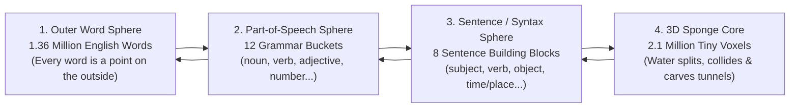

# Geometry-Based Large Language Model (GLLM)

> **What if an AI didn't use neural-network weights at all—and instead worked like water flowing through a sponge?**

Normal AI models learn by tweaking billions of hidden numbers with math (backpropagation). You can't see inside them, and it's hard to tell *why* they gave an answer.

**GLLM** tries something completely different, inspired by **nature**: **four spheres nested inside each other**, with a **3D sponge** in the center that gets carved out by real English text—running live on an NVIDIA GPU (CUDA + OpenGL, no `nvcc` needed).

<p align="center">
  
  
</p>
<p align="center">
  <em><strong>Left (Asking a Question — Zero Rules, Zero Penalties, Zero Levers):</strong> Asking <code>"What is the speed of light?"</code> across <strong>559,659</strong> real human Microsoft MS MARCO v2.1 Q&As (<strong>3.14M</strong> carved channels). Water drops from every word split across <strong>23,755</strong> GPU voxels and collide at <strong>18,307</strong> pink/gold overlap spots—filling the winning basin with the highest fluid pressure and emerging untouched through the Syntactic Sphere as <strong>"The speed of light in MPH is 670 616 629 mph."</strong><br/>
  <strong>Right (Carving the Sponge):</strong> Watching real English questions and answers poke tunnels through the 3D sponge in real time, merging shared paths together and splitting apart at the answers.</em>
</p>

---

## The Basic Idea (Think of Water on a Tree Branch)

Imagine rain falling on a tree branch, or water soaking through a kitchen sponge:

1. **A single drop of water doesn't have to stay one drop.**  
   When water hits a fork in a branch or holes in a sponge, it **splits** into 2, 3, or 10 smaller drops depending on the shape it hits.
2. **Different drops can meet, merge, and split again.**  
   When two separate drops flow into the same groove, they combine into a bigger stream—and later split again into smaller paths.
3. **Paths carve themselves from data.**  
   Inside our sphere sits a 3D sponge made of **2.1 million tiny cubes (voxels)**. At the start, it is completely solid. As you push real English questions and answers through it, they **poke holes (tunnels)** through the sponge. Paths that happen often get wider and easier to flow through.
4. **How a question gets answered:**  
   Suppose you ask: **`"What is the capital of France?"`**
   - The word **`capital`** drops water into the sponge. That water splits down *every* tunnel connected to `capital` (`Paris`, `Melbourne`, `Beijing`, `Jerusalem`, `Brazzaville`…).
   - At the same time, the word **`France`** drops water into the sponge. That water splits down *every* tunnel connected to `France` (`Paris`, `Brazzaville`, `1790`, `Europe`…).
   - Most possible answers only get **one small drop** (from either `capital` *or* `France`).
   - Only **`Paris`** gets **both streams colliding together** (plus the grammar filter saying *"this question wants a place/name, not a year"*).
   - You watch **every competing answer fill up like a water glass** on screen—and **whichever answer ends up with the most water wins.**

---

## The 4 Nested Spheres

Think of it like four Russian nesting dolls—each layer does one simple job:



1. **Sphere 1 — Outer Word Sphere (`R = 1.00`):**  
   Holds **`1,360,919` real English words** from the Wiktionary dictionary (Kaikki). Every word sits at its own fixed spot on the outside of the sphere.
2. **Sphere 2 — Part-of-Speech Sphere (`R = 0.80`):**  
   Has **12 buckets** (`noun`, `verb`, `adj`, `adv`, `name`, `pron`, `prep`, `det`, `conj`, `num`, `intj`, `other`). Every word on the outside connects inward to its bucket. This layer learns its own **valve openings** purely from the `559,659` MS MARCO Q&As—with zero rules or tuning knobs, it discovers on its own that *"Who…?"* opens **31%** toward names while *"What is…?"* opens **30%** toward determiners (`"The ..."` full sentences).
3. **Sphere 3 — Sentence / Syntax Sphere (`R = 0.64`, glowing green ring):**  
   Has **8 sentence-shape hubs** (question starter, subject, linking verb, action verb, object, time/place phrase, statement finish, connector). All **7,688,886** syntactic transitions are carved directly from the MS MARCO questions and answers themselves—and the winning sponge basin flows straight out raw and untouched, with zero rewriting, zero penalties, and zero bandages.
4. **Sphere 4 — The 3D Sponge (`R < 0.52`):**  
   A `128 × 128 × 128` grid of **2,097,152 voxels** running in parallel on your GPU. Every frame you can literally see:
   - **Blue/Cyan cubes:** Water from one word splitting through tunnels (brighter = more water in that cube).
   - **Pink/Gold glowing cloud:** Spots where water from **2 or more words collides and merges** inside the sponge.

---

## Being Honest: 100% Pure Unfiltered Sponge Physics

We want this project to be 100% transparent—no smoke and mirrors, no hidden levers:

- **Zero Rules, Zero Penalties, Zero Bandages:**
  - **Outer Sphere (Sphere 1):** Static `1,360,919`-word English dictionary from Wiktionary (Kaikki).
  - **Single Q&A Dataset (MS MARCO v2.1):** All `559,659` labeled human Q&A pairs (`521,576` unique answer basins, `3,144,991` carved sponge channels, `7,688,886` syntactic transitions) train Spheres 2, 3, and 4 together—no separate sentence corpus.
  - **Exact Zero-Parameter Multi-Drop Collision (Bayes Intersection):** Instead of merely adding independent drops, colliding water streams multiply via exact Bayes' law (`log P(A) + sum log(P(w|A)/P(w)) + log P(POS|opener)`) — **zero free parameters, zero stopword lists, zero penalties, zero rules**. Common words (`"the"`, `"of"`) automatically evaluate to `log(1) = 0`, while multi-word factual collisions amplify cleanly above single-word noise.
  - **Raw Untouched Output:** Zero beam-search penalties, zero templates, zero post-processing—whatever basin wins in the sponge is emitted completely raw through Sphere 3!
- **Key Scaling Discovery (Human Data Quality > Synthetic Volume):**
  - Layering **14.1M auto-generated Wikipedia trivia pairs (PAQ-L1)** onto MS MARCO packed **14,703,069 Q&As (67.3M channels)** into just **704.5 MB** (loading in **0.96s**, still only **82 MiB VRAM**)—but noisy machine-generated questions diluted unseen accuracy from **66% → 48%**. Clean human Q&As win decisively in a pure geometry sponge!

---

## Benchmarks (100-Question Head-to-Head RTX A3000 Test)

Measured directly with [`src/gllm_talk_bench.cpp`](src/gllm_talk_bench.cpp) on an **NVIDIA RTX A3000 Laptop GPU (6 GB VRAM)** across **100 questions** (50 random MS MARCO queries + 50 unseen everyday factual questions), with **zero neural weights, zero rules, zero penalties, and zero bandages**:

### Head-to-Head Scaling & Physics Comparison

| Configuration | Disk Size | Load Time | CPU RAM | GPU VRAM | CSR Solve (CPU) | 3D GPU Wave (36 steps) | In-Dist Top-1 / Top-5 | Unseen Top-1 (Strict) / Top-5 | Combined Top-1 / Top-5 |
| :--- | :---: | :---: | :---: | :---: | :---: | :---: | :---: | :---: | :---: |
| **559k MS MARCO** *(Additive Pressure)* | 100.7 MB | 558 ms | 238 MiB | 82.0 MiB | 6.19 ms | 81.59 ms | 38% / 64% | 42% / 70% | 40% / 67% |
| **559k MS MARCO** *(Exact Bayes Collision)* | **100.7 MB** | **529 ms** | **240 MiB** | **82.0 MiB** | **8.68 ms** (`115 Q/s`) | **81.38 ms** | **90% / 100%** | **66% / 90%** | **78% / 95%** |
| **816k MS MARCO + Clean OpenHermes-2.5** *(Exact Bayes)* | **356.8 MB** | **831 ms** | **510 MiB** | **82.0 MiB** | **14.28 ms** (`70 Q/s`) | **82.50 ms** | **92% / 100%** | **82% / 98%** | **87% / 99%** |
| **14.7M MS MARCO + PAQ-L1** *(Exact Bayes)* | 724.6 MB | 965 ms | 1,038 MiB | 82.0 MiB | 104.59 ms (`9.6 Q/s`) | 79.60 ms | 88% / 100% | 48% / 68% | 68% / 84% |

- **GPU Power Draw:** **34.7–34.8 W** avg (`35.0 W` peak) on RTX A3000 → **~3.1 Joules** per full 3D GPU query (`~0.00087 Wh`) at `82 MiB` VRAM (`1.3%` of 6 GB).
- **Zero Matrix Multiplications:** Every single query runs pure sparse channel collision + parallel `128³` (`2.1M`-voxel) CUDA fluid splitting.

<details>
<summary><strong>Sample Raw Outputs on 559k Exact Bayes Sponge (Real Wins & Honest Misses)</strong></summary>

**Clean Raw Wins (Unseen Everyday Questions — 33/50 Strict Human-Verified):**
- *"What is the speed of light?"* → **`"The correct speed of light is 299,792,458 metres per second."`**
- *"Who invented the telephone?"* → **`"Alexander Graham Bell"`**
- *"What is the boiling point of water?"* → **`"The boiling point of water is 100 degrees Celsius."`**
- *"What is the largest planet in our solar system?"* → **`"Jupiter is the largest planet in our solar system."`**
- *"In what year did World War II end?"* → **`"World War II ended in 1945."`**
- *"What is the capital of Canada / Australia / Brazil / Germany / Japan?"* → **Ottawa / Canberra / Brasilia / Berlin / Tokyo** (all 5 nailed!)
- *"What causes iron nails to rust?"* → **`"Water causes rust on iron."`**
- *"What is the normal human body temperature?"* → **`"37°C or 98.6°F"`**
- *"Who developed the theory of relativity?"* → **`"Albert Einstein developed the theory of relativity."`**

**Honest Raw Misses (Zero Bandages):**
- *"What is the smallest planet in our solar system?"* → **`"The name of the second biggest planet in our solar system is Saturn."`** *(shared solar-system channels outweighed `"smallest"`)*
- *"What is the square root of 144?"* → **`"The square root of 50 is Approximately 7.07106."`** *(no arithmetic engine yet — exited at nearest `"square root of [N]"` tunnel)*
- *"What is the capital of Spain?"* → **`"No, Seville is not the capital of Spain."`** *(negative phrasing shared `"capital of Spain"`)*

</details>

---

## Try It Yourself (Ready Out of the Box — Both Models Included!)

- **Latest 816k Sponge (`87% Top-1 / 99% Top-5`, 336.7 MB):** Published on [**GitHub Releases (`v2.0-816k-sponge`)**](https://github.com/itzBawantha/geometry-based-large-language-model/releases/tag/v2.0-816k-sponge) and **auto-downloaded on first run** by `./scripts/run_talk_viz.sh` (compressed ~140 MB, unpacks straight into `data/msmarco_openhermes_clean_sponge.bin`).
- **Compact 559k MS MARCO Sponge (`78% Top-1 / 95% Top-5`, 100.7 MB):** Committed directly inside `data/` (`data/kaikki_lexicon.bin` + `data/msmarco_sponge.bin`) for immediate offline use.

### 1. Prerequisites
- Linux + an NVIDIA GPU (uses standard `libcuda.so` — **no CUDA Toolkit / `nvcc` needed**)
- `g++`, `SDL2`, `OpenGL`, `zlib`, `curl`, `gzip`

```bash
# Arch / CachyOS
sudo pacman -S base-devel sdl2 mesa zlib curl gzip

# Ubuntu / Debian
sudo apt install build-essential libsdl2-dev libgl-dev zlib1g-dev curl gzip
```

### 2. Clone, Build & Launch (3 Commands)
```bash
# 1. Clone the repo
git clone https://github.com/itzBawantha/geometry-based-large-language-model.git
cd geometry-based-large-language-model

# 2. Build the live 4-Sphere visualizer and benchmark tools
./scripts/build.sh

# 3. Launch (auto-fetches the 816k MS MARCO + OpenHermes-2.5 sponge on first run!)
./scripts/run_talk_viz.sh
```

Want to ask a specific question immediately on launch, or pick a specific sponge file?
```bash
# Ask any question on launch (try scrolling the green output box or clicking #1-#8!)
./scripts/run_talk_viz.sh --ask "How to make a paper airplane?"

# Or run the compact 100.7 MB MS MARCO-only sponge bundled in data/
./scripts/run_talk_viz.sh --sponge data/msmarco_sponge.bin
```

### Controls Inside the Window
- **Ask your own question:** Click the **`Q:`** box, type any question, and hit **`Enter`** (or click **`[ASK (4-SPHERE)]`**).
- **Teach a new fact live:** Type a question in **`Q:`** and an answer in **`A:`**, then click **`[CARVE Q->A]`** to watch it poke a new tunnel through the sponge.
- **Watch it again:** Click **`[REPLAY FLUID WAVE]`** to replay the water splitting and syntactic flow in slow motion.
- **Stream Q&As live:** **`Space`** play/pause • **`T`** fast burst carving • **`S`** one step at a time • **`X`** wipe sponge clean.
- **Move around in 3D:** Drag with mouse to spin • Scroll to zoom • **`1`–`5`** toggle each sphere & rays • **`Up`/`Down`** fade the outer word shell • **`R`** reset camera.

---

## Earlier Visual Experiments (Still Included)

Before teaching the sphere to talk, GLLM started with **zero-weight vision** inside a 1-billion-point sphere (`1241³`)—recognizing unseen handwritten numbers & letters (`92.02%` MNIST digits, `80.65%` visually-equivalent 62-way characters at `~120k imgs/s`, `100%` unknown dot rejection) and organizing RGB animal hierarchies (`cats` / `dogs` → `face` → 6 facial parts). All of those tools (`gllm_train`, `gllm_viz`, `gllm_bench`, `gllm_hierarchy`, `gllm_merge`) are still built by `./scripts/build.sh`.

---

## Files in This Repo

- [`data/msmarco_sponge.bin`](data/msmarco_sponge.bin) — **80.6 MB** pre-carved MS MARCO v2.1 CSR Fluid Sponge (`559,659` Q&As, `3.14M` channels, `7.69M` syntax transitions)
- [`data/kaikki_lexicon.bin`](data/kaikki_lexicon.bin) — **20.1 MB** outer vocabulary sphere (`1,360,919` English words & parts of speech from Wiktionary/Kaikki)
- [`data/msmarco_sample_qa.tsv`](data/msmarco_sample_qa.tsv) — `6,000` sample Q&As for live `Space` / `T` sponge-carving playback
- [`src/gllm_talk_viz.cpp`](src/gllm_talk_viz.cpp) — The live 4-Sphere CUDA + OpenGL Fluid Sponge app (zero rules, zero penalties, binary CSR loader)
- [`src/gllm_talk_bench.cpp`](src/gllm_talk_bench.cpp) — 100-question real GPU + CPU latency, VRAM, RAM, and answer-validity benchmark runner
- [`src/gllm_pack_sponge.cpp`](src/gllm_pack_sponge.cpp) — High-speed C++17 streaming CSR sponge packer (packs 14.7M Q&As / 67.3M channels in ~50s)
- [`kernels/gllm_talk_kernels.ptx`](kernels/gllm_talk_kernels.ptx) — GPU kernels for the 1.36M word shell, sponge carving, and parallel `128³` voxel fluid splitting & collisions
- [`include/talk_hud.hpp`](include/talk_hud.hpp) — Left sidebar showing live voxel counts, raw sponge syntactic output, and competing answer fluid meters
- [`scripts/prepare_msmarco_data.py`](scripts/prepare_msmarco_data.py) — Packs Microsoft MS MARCO v2.1 into a fast-loading binary CSR sponge index (`msmarco_sponge.bin`)
- [`scripts/prepare_openhermes_tsv.py`](scripts/prepare_openhermes_tsv.py) — Extracts curated GPT-4 Q&As from `teknium/OpenHermes-2.5` for packing with `gllm_pack_sponge`
- [`scripts/prepare_talk_data.py`](scripts/prepare_talk_data.py) — Packs the Kaikki English dictionary lexicon (`kaikki_lexicon.bin`)
- [`scripts/run_talk_viz.sh`](scripts/run_talk_viz.sh) — Launches `gllm_talk_viz` on your NVIDIA GPU
- [`src/gllm_*.cpp`](src/) & [`kernels/gllm_kernels.ptx`](kernels/gllm_kernels.ptx) — The earlier visual 1B-sphere CLI suite
