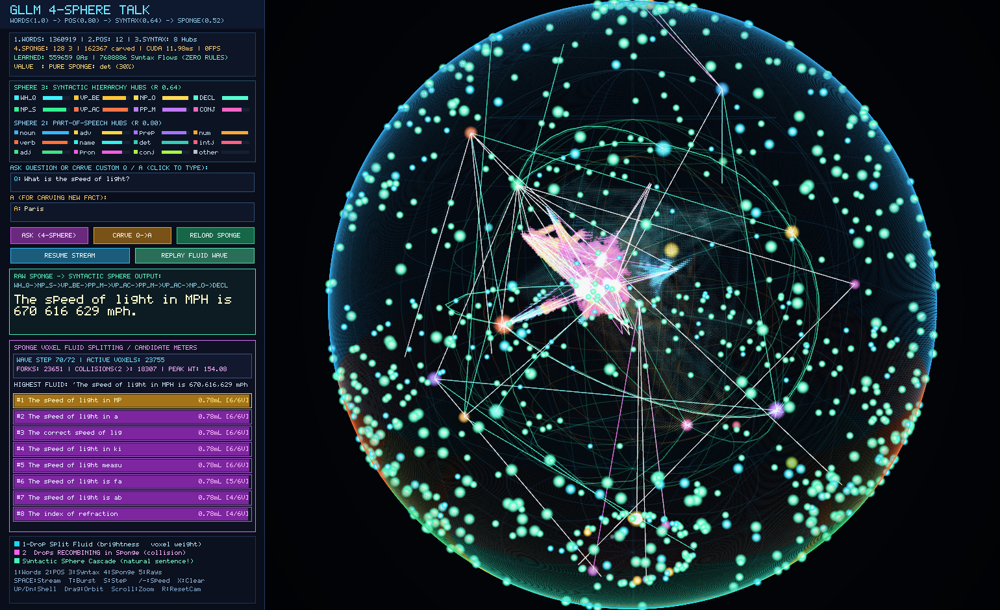
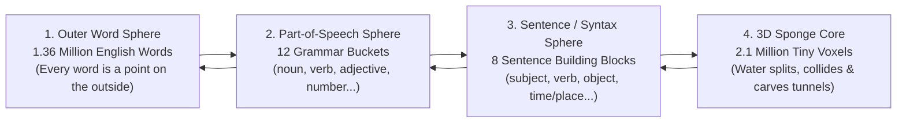

# Geometry-Based Large Language Model (GLLM)

> **What if an AI didn't use neural-network weights at all—and instead worked like water flowing through a sponge?**

Normal AI models learn by tweaking billions of hidden numbers with math (backpropagation). You can't see inside them, and it's hard to tell *why* they gave an answer.

**GLLM** tries something completely different, inspired by **nature**: **four spheres nested inside each other**, with a **3D sponge** in the center that gets carved out by real English text—running live on an NVIDIA GPU (CUDA + OpenGL, no `nvcc` needed).

<p align="center">
  
  
</p>
<p align="center">
  <em><strong>Left (Asking a Question — Zero Rules, Zero Penalties, Zero Levers):</strong> Asking <code>"What is the speed of light?"</code> across <strong>559,659</strong> real human Microsoft MS MARCO v2.1 Q&As (<strong>3.14M</strong> carved channels). Water drops from every word split across <strong>23,755</strong> GPU voxels and collide at <strong>18,307</strong> pink/gold overlap spots—filling the winning basin with the highest fluid pressure and emerging untouched through the Syntactic Sphere as <strong>"The speed of light in MPH is 670 616 629 mph."</strong><br/>
  <strong>Right (Carving the Sponge):</strong> Watching real English questions and answers poke tunnels through the 3D sponge in real time, merging shared paths together and splitting apart at the answers.</em>
</p>

---

## The Basic Idea (Think of Water on a Tree Branch)

Imagine rain falling on a tree branch, or water soaking through a kitchen sponge:

1. **A single drop of water doesn't have to stay one drop.**  
   When water hits a fork in a branch or holes in a sponge, it **splits** into 2, 3, or 10 smaller drops depending on the shape it hits.
2. **Different drops can meet, merge, and split again.**  
   When two separate drops flow into the same groove, they combine into a bigger stream—and later split again into smaller paths.
3. **Paths carve themselves from data.**  
   Inside our sphere sits a 3D sponge made of **2.1 million tiny cubes (voxels)**. At the start, it is completely solid. As you push real English questions and answers through it, they **poke holes (tunnels)** through the sponge. Paths that happen often get wider and easier to flow through.
4. **How a question gets answered:**  
   Suppose you ask: **`"What is the capital of France?"`**
   - The word **`capital`** drops water into the sponge. That water splits down *every* tunnel connected to `capital` (`Paris`, `Melbourne`, `Beijing`, `Jerusalem`, `Brazzaville`…).
   - At the same time, the word **`France`** drops water into the sponge. That water splits down *every* tunnel connected to `France` (`Paris`, `Brazzaville`, `1790`, `Europe`…).
   - Most possible answers only get **one small drop** (from either `capital` *or* `France`).
   - Only **`Paris`** gets **both streams colliding together** (plus the grammar filter saying *"this question wants a place/name, not a year"*).
   - You watch **every competing answer fill up like a water glass** on screen—and **whichever answer ends up with the most water wins.**

---

## The 4 Nested Spheres

Think of it like four Russian nesting dolls—each layer does one simple job:



1. **Sphere 1 — Outer Word Sphere (`R = 1.00`):**  
   Holds **`1,360,919` real English words** from the Wiktionary dictionary (Kaikki). Every word sits at its own fixed spot on the outside of the sphere.
2. **Sphere 2 — Part-of-Speech Sphere (`R = 0.80`):**  
   Has **12 buckets** (`noun`, `verb`, `adj`, `adv`, `name`, `pron`, `prep`, `det`, `conj`, `num`, `intj`, `other`). Every word on the outside connects inward to its bucket. This layer learns its own **valve openings** purely from the `559,659` MS MARCO Q&As—with zero rules or tuning knobs, it discovers on its own that *"Who…?"* opens **31%** toward names while *"What is…?"* opens **30%** toward determiners (`"The ..."` full sentences).
3. **Sphere 3 — Sentence / Syntax Sphere (`R = 0.64`, glowing green ring):**  
   Has **8 sentence-shape hubs** (question starter, subject, linking verb, action verb, object, time/place phrase, statement finish, connector). All **7,688,886** syntactic transitions are carved directly from the MS MARCO questions and answers themselves—and the winning sponge basin flows straight out raw and untouched, with zero rewriting, zero penalties, and zero bandages.
4. **Sphere 4 — The 3D Sponge (`R < 0.52`):**  
   A `128 × 128 × 128` grid of **2,097,152 voxels** running in parallel on your GPU. Every frame you can literally see:
   - **Blue/Cyan cubes:** Water from one word splitting through tunnels (brighter = more water in that cube).
   - **Pink/Gold glowing cloud:** Spots where water from **2 or more words collides and merges** inside the sponge.

---

## Being Honest: 100% Pure Unfiltered Sponge Physics

We want this project to be 100% transparent—no smoke and mirrors, no hidden levers:

- **Zero Rules, Zero Penalties, Zero Bandages:**
  - **Outer Sphere (Sphere 1):** Static `1,360,919`-word English dictionary from Wiktionary (Kaikki).
  - **Single Q&A Dataset (MS MARCO v2.1):** All `559,659` labeled human Q&A pairs (`521,576` unique answer basins, `3,144,991` carved sponge channels, `7,688,886` syntactic transitions) train Spheres 2, 3, and 4 together—no separate sentence corpus.
  - **Pure Symmetric Fluid Physics:** Every question word pours an equal `1000 mL` droplet divided proportionally across all carved channels (`count / word_total_count` — **no stopword lists, no exponents, no cutoffs**). Colliding droplets simply add together and divide by each answer basin's own capacity (`inflow / basin_hits` — pure fluid pressure, **no heuristic collision multipliers**), then pass through Sphere 2's raw learned POS fraction (`v_counts[pos] / v_tot`).
  - **Raw Untouched Output:** Zero beam-search penalties, zero templates, zero post-processing—whatever basin wins in the sponge is emitted completely raw through Sphere 3, even when a missing fact or rare word produces a raw/imperfect answer!
- **What's Next (Scaling Past 1M → 15M+ Q&As):**
  - MS MARCO v2.1 has `559,659` answered human Q&As (out of `909,824` train+dev queries), so facts absent from MS MARCO (like *"What is the capital of France?"*) still fall back to nearby carved shape neighbors (*"The capital of Holland is Amsterdam."*).
  - **Next goal:** Combine MS MARCO with multi-million Q&A archives like **PAQ-L1 (14.1M)** and **TQA+NQ+PAQ (65M)** into the exact same binary CSR sponge format so every sphere gets deeper, richer geometry purely from data.

---

## Try It Yourself (Live 3D on Your GPU)

### What You Need
- Linux + an NVIDIA GPU (uses standard `libcuda.so` — **no CUDA Toolkit / `nvcc` needed**)
- `g++`, `SDL2`, `OpenGL`, `zlib`, `python3`, `curl`

```bash
# Arch / CachyOS
sudo pacman -S base-devel sdl2 mesa zlib curl python

# Ubuntu / Debian
sudo apt install build-essential libsdl2-dev libgl-dev zlib1g-dev curl python3
```

### Build & Run
```bash
# 1. Build the visualizer (and all GLLM tools)
./scripts/build.sh

# 2. Pack the Kaikki lexicon + Microsoft MS MARCO v2.1 CSR binary sponge
python3 scripts/prepare_msmarco_data.py

# 3. Launch the live 4-Sphere Fluid Sponge!
./scripts/run_talk_viz.sh --ask "What is the speed of light?"
```

### Controls Inside the Window
- **Ask your own question:** Click the **`Q:`** box, type any question, and hit **`Enter`** (or click **`[ASK (4-SPHERE)]`**).
- **Teach a new fact live:** Type a question in **`Q:`** and an answer in **`A:`**, then click **`[CARVE Q->A]`** to watch it poke a new tunnel through the sponge.
- **Watch it again:** Click **`[REPLAY FLUID WAVE]`** to replay the water splitting and syntactic flow in slow motion.
- **Stream Q&As live:** **`Space`** play/pause • **`T`** fast burst carving • **`S`** one step at a time • **`X`** wipe sponge clean.
- **Move around in 3D:** Drag with mouse to spin • Scroll to zoom • **`1`–`5`** toggle each sphere & rays • **`Up`/`Down`** fade the outer word shell • **`R`** reset camera.

---

## Earlier Visual Experiments (Still Included)

Before teaching the sphere to talk, GLLM started with **zero-weight vision** inside a 1-billion-point sphere (`1241³`)—recognizing unseen handwritten numbers & letters (`92.02%` MNIST digits, `80.65%` visually-equivalent 62-way characters at `~120k imgs/s`, `100%` unknown dot rejection) and organizing RGB animal hierarchies (`cats` / `dogs` → `face` → 6 facial parts). All of those tools (`gllm_train`, `gllm_viz`, `gllm_bench`, `gllm_hierarchy`, `gllm_merge`) are still built by `./scripts/build.sh`.

---

## Files in This Repo

- [`src/gllm_talk_viz.cpp`](src/gllm_talk_viz.cpp) — The live 4-Sphere CUDA + OpenGL Fluid Sponge app (zero rules, zero penalties, binary CSR loader)
- [`kernels/gllm_talk_kernels.ptx`](kernels/gllm_talk_kernels.ptx) — GPU kernels for the 1.36M word shell, sponge carving, and parallel `128³` voxel fluid splitting & collisions
- [`include/talk_hud.hpp`](include/talk_hud.hpp) — Left sidebar showing live voxel counts, raw sponge syntactic output, and competing answer fluid meters
- [`scripts/prepare_msmarco_data.py`](scripts/prepare_msmarco_data.py) — Packs Microsoft MS MARCO v2.1 into a fast-loading binary CSR sponge index (`msmarco_sponge.bin`)
- [`scripts/prepare_talk_data.py`](scripts/prepare_talk_data.py) — Packs the Kaikki English dictionary lexicon (`kaikki_lexicon.bin`)
- [`scripts/run_talk_viz.sh`](scripts/run_talk_viz.sh) — Launches `gllm_talk_viz` on your NVIDIA GPU
- [`src/gllm_*.cpp`](src/) & [`kernels/gllm_kernels.ptx`](kernels/gllm_kernels.ptx) — The earlier visual 1B-sphere CLI suite
