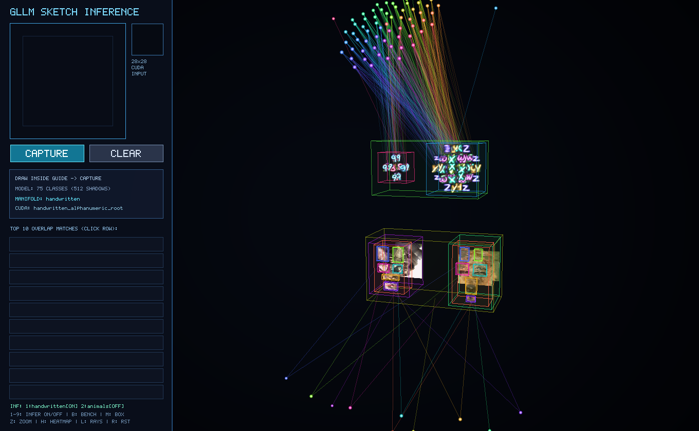
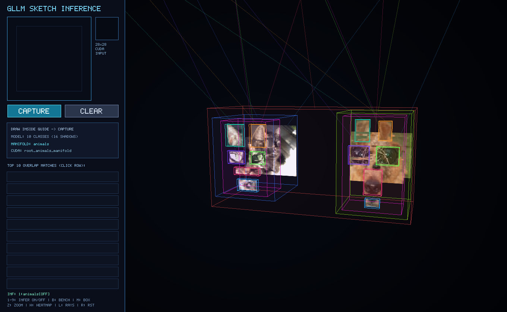
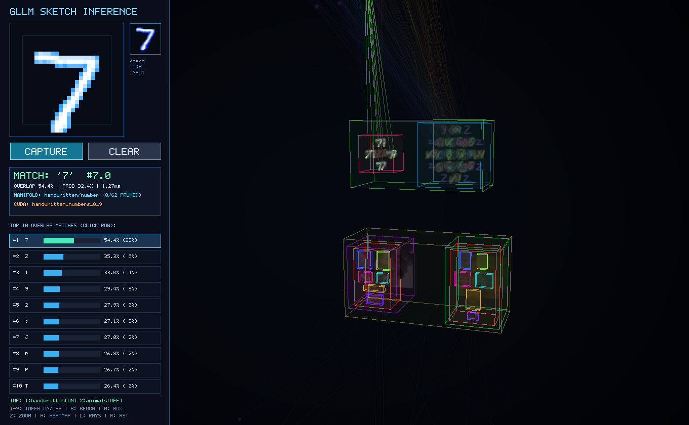
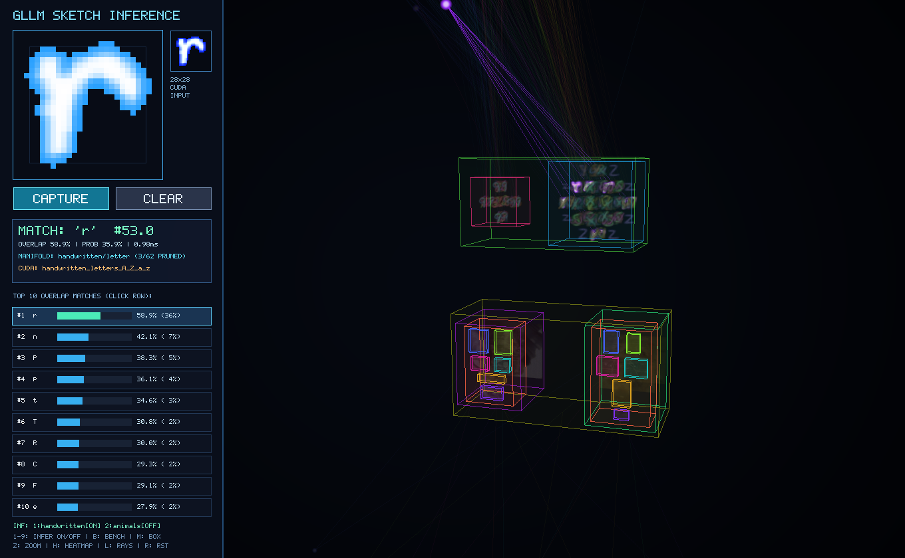
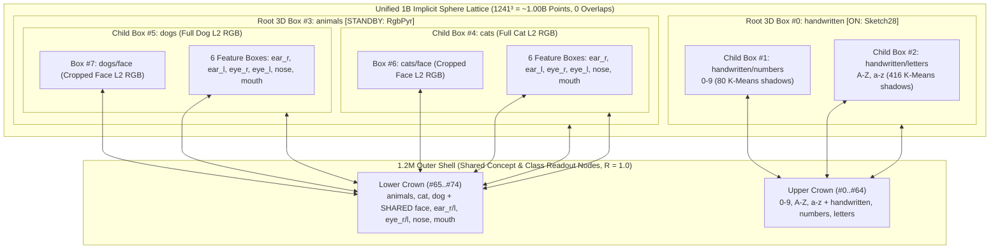

# Geometry-Based Large Language Model (GLLM)

> **Intelligence represented purely as geometry** — a zero-weight, zero-backpropagation CUDA Driver API + OpenGL 4.6 geometric intelligence engine running inside a unified **1-billion-point implicit 3D sphere lattice (`1241³`)** bound to a **1.2M-point outer concept shell** (`R = 1.0`). No `nvcc` / CUDA Toolkit required.

<p align="center">
  
  
</p>
<p align="center">
  <em><strong>Left:</strong> Unified 1B Universe Sphere (<code>models/universe_1b.gllm</code>) hosting <code>handwritten</code> (upper hemisphere, 65 outer nodes, <code>ON:Sketch28</code>) and <code>animals</code> (lower hemisphere, 10 shared outer concept nodes, <code>OFF:RgbPyr</code>) with <strong>0 spatial overlaps</strong> and <strong>2,048 / 2,048 corners (100%)</strong> enclosed.<br/>
  <strong>Right:</strong> 4-level true-RGB hierarchical 3D bounding-box manifolds (<code>animals → cats / dogs → face → 6 facial features</code>) with every pixel mapped 1-to-1 into CUDA VRAM and matching features converging to shared concept nodes on the outer shell.</em>
</p>

### Live Unseen Capture & GPU Manifold Routing (Zero Weights, Unseen Inputs)

GLLM already generalizes to **completely unseen handwritten numbers and letters** that never appeared in the training set—routing each input on the GPU directly to its child manifold and firing binding rays from the winning sub-shadows to the outer-shell concept node:

<p align="center">
  
  
</p>
<p align="center">
  <em><strong>Left (Unseen Number Capture):</strong> Unseen MNIST test digit <code>'7'</code> matched in <code>1.27 ms</code> (<code>54.4%</code> overlap, <code>32.4%</code> rel-prob), routed on CUDA to <code>handwritten/numbers</code> (<code>CUDA: handwritten_numbers_0_9</code>), spotlighting all 8 structural <code>'7'</code> sub-shadows and firing binding rays straight to Outer Node <code>#7.0</code> while <code>animals</code> remains isolated in standby below.<br/>
  <strong>Right (Unseen Letter Capture):</strong> Unseen EMNIST test letter <code>'r'</code> matched in <code>0.98 ms</code> (<code>58.9%</code> overlap, <code>35.9%</code> rel-prob), routed on CUDA to <code>handwritten/letters</code> (<code>CUDA: handwritten_letters_A_Z_a_z</code>), firing rays directly to glowing Outer Node <code>#53.0</code>.</em>
</p>

---

## Core Idea: Hierarchical 3D Bounding-Box Manifolds & Shared Outer Concepts

Traditional neural networks entangle every learned skill into shared floating-point weights trained by backpropagation—making continual learning prone to catastrophic forgetting and internal reasoning opaque.

GLLM separates **spatial memory** from **shared semantic concepts**:

1. **Nested 3D Bounding-Box Manifolds (Zero Spatial Overlap):**
   - Every subject domain (`handwritten`, `animals`, or any future domain such as `shapes`, `vehicles`, `audio`) occupies its own strictly disjoint root 3D bounding box inside the `1241³` (~1.00B-point) implicit lattice.
   - Inside each root domain, child concepts nest as exact **3D Axis-Aligned Bounding Boxes (AABBs)** propagated bottom-up—guaranteeing **100.0% pixel & child-box containment** and **zero spatial interference**.
   - At the CUDA level (`GpuManifoldDesc`, 144 bytes in VRAM), knowing which nested 3D box a lattice point resides in immediately resolves its full semantic lineage (e.g., `cats/face/eye_right → cats/face → cats → animals`).
2. **Shared Concept Vocabulary on the 1.2M Outer Shell (`R = 1.0`):**
   - Interior sub-manifolds stay physically separate (zero forgetting), while **shared concepts converge onto a single outer-shell concept node** via binding rays.
   - For example, both `cats/face` and `dogs/face` sit inside their own species boxes with zero overlap, yet **both fire rays to the single shared `'face'` node** on the outer shell—and the same holds for all 6 shared facial features (`ear_right`, `ear_left`, `eye_right`, `eye_left`, `nose`, `mouth`).
3. **True Per-Point RGB + Luminance in CUDA VRAM (`.gllm` v5):**
   - Every mapped lattice point stores luminance (`float shadow_sum`) and optional packed **true RGB (`uint32_t 0x01RRGGBB`)** unpacked directly inside `kernels/gllm_kernels.ptx`, supporting both grayscale probability shadows (`handwritten`) and full-color Burt-Adelson Gaussian Pyramid lattices (`animals`).
4. **Generalized Per-Manifold Inference Dispatcher ([include/inference_dispatcher.hpp](include/inference_dispatcher.hpp)):**
   - Each root parent manifold carries self-describing `inference_flags` (`enabled` bit + `InferenceModality`: `Sketch28`, `RgbPyr`, `Custom`, `None`).
   - Disabling a parent manifold—or querying with a different modality—sets its CUDA hardware bitmask to `0ULL`, so the GPU prunes all of its regions in **2 clock cycles** with zero accuracy or speed impact on active domains.
   - Press **`1`–`9`** live in `gllm_viz` (or pass `--enable-manifold` / `--disable-manifold`) to toggle inference for any parent manifold dynamically without recompiling.



---

## Dynamic Per-Manifold Inference Dispatch (Adaptable Across Any Parent Concept)

As GLLM grows to hold many independent subject areas inside one shared 1B sphere (`handwritten`, `animals`, and future domains), different parent concept manifolds require different inference engines—and developers need to enable, disable, or swap inference per domain **without recompiling or touching other domains**.

GLLM solves this generally through [include/inference_dispatcher.hpp](include/inference_dispatcher.hpp) and `.gllm` v5 metadata:

1. **Self-Describing Modality Metadata in CUDA VRAM (`GpuManifoldDesc`):**
   - Every manifold stores `inference_flags` (bit `0` = `enabled`, bits `8..15` = `InferenceModality`: `Sketch28`, `RgbPyr`, `Custom`, `None`), mirrored directly into its 144-byte CUDA VRAM register.
2. **Hierarchical Root Inheritance (One Switch Controls an Entire Concept Tree):**
   - Eligibility walks upward from any leaf region through `parent_manifold_id` to its depth-0 root (`is_manifold_inference_active`). Flipping a single root switch (e.g., `handwritten` or `animals`) atomically enables or disables its entire nested hierarchy (`numbers` + `letters`, or `cats` + `dogs` + `face` + 12 facial features).
3. **2-Cycle Hardware Bitmask Isolation on GPU:**
   - Before each query, `InferenceDispatcher::build_active_gpu_masks()` assigns `0ULL` to the 64-bit coarse bitmask of every region belonging to a disabled or non-matching-modality root manifold.
   - Inside `match_sketch_pruned`, the GPU skips all inactive branches in **2 clock cycles** (`and.b64` + `popc.b64`)—so inactive domains incur zero accuracy interference and negligible compute cost.
4. **Live Runtime & CLI Adaptation (Zero Recompile):**
   - **Live in `gllm_viz`:** Press **`1`–`9`** anytime to toggle each root parent manifold ON/OFF live on CUDA (reflected immediately in the bottom-left `INF: 1:handwritten[ON] 2:animals[OFF]` bar).
   - **Via CLI:** Pass `--enable-manifold <name>` or `--disable-manifold <name>` to `gllm_viz`, or set default boot states when merging domains with `gllm_merge --infer on|off --modality sketch28|rgb`.
   - **Pluggable Future Modalities:** When a new inference kernel (such as `RgbPyr` multi-part constellation matching for `animals`) is ready, it registers cleanly under its modality ID in `InferenceDispatcher` and immediately activates whenever its parent manifold is toggled `ON`.

---

## Modular GPU CLI Suite (Zero `nvcc` Required)

All 8 standalone C++17 / CUDA Driver API (`libcuda.so`) tools share the backwards-compatible `.gllm` binary format (v1–v5) and JIT-compile `kernels/gllm_kernels.ptx` directly through the NVIDIA driver:

| CLI Tool | Source | Purpose |
|---|---|---|
| **`bin/gllm_train`** | [src/gllm_train.cpp](src/gllm_train.cpp) | GPU atomic shadow trainer & Spherical K-Means (`--clusters K`) with hierarchical 3D bounding-box flags (`--parent-manifold`, `--manifold`, `--manifold-concept`, `--envelope-box`, `--anchor`). |
| **`bin/gllm_pyramid`** | [src/gllm_pyramid.cpp](src/gllm_pyramid.cpp) | Decodes any RGB image, optionally crops a bounding box (`--crop x0,y0,x1,y1`), runs a 5-tap Burt-Adelson RGB Gaussian Pyramid, and maps selected octave(s) (`--select-level 2`) pixel-by-pixel into the 1B lattice. |
| **`bin/gllm_hierarchy`** | [src/gllm_hierarchy.cpp](src/gllm_hierarchy.cpp) | Builds the 4-level 17-manifold RGB `animals` hierarchy (`animals → cats/dogs → face → 6 features`) using exact dataset face & feature bounding boxes with shared outer-shell concept nodes. |
| **`bin/gllm_merge`** | [src/gllm_merge.cpp](src/gllm_merge.cpp) | Merges arbitrary independent `.gllm` domain models into a single unified 1B universe sphere with non-overlapping 3D shifts, remapped concept crowns, and per-root `--infer on\|off --modality sketch28\|rgb`. |
| **`bin/gllm_eval`** | [src/gllm_eval.cpp](src/gllm_eval.cpp) | Batch GPU holdout evaluator (`eval_score_shadows`) max-pooling across every class's `K` sub-shadows. |
| **`bin/gllm_bench`** | [src/gllm_bench.cpp](src/gllm_bench.cpp) | Reproducible audit suite: verifies **0 spatial overlaps**, **100% multi-level box containment**, CUDA **`GpuManifoldDesc` register routing**, full **68,405-image holdout**, multi-scale pyramid checks, and **OOD rejection**. |
| **`bin/gllm_inspect`** | [src/gllm_inspect.cpp](src/gllm_inspect.cpp) | Displays, queries (`--label` / `--value`), or exports (`--json` / `--csv`) the full manifold hierarchy tree, inference status/modality, outer-shell concept table, and 3D lattice coordinates. |
| **`bin/gllm_viz`** | [src/gllm_viz.cpp](src/gllm_viz.cpp) | Zero-copy CUDA–OpenGL 4.6 3D visualizer rendering nested 3D bounding boxes, true per-point RGB & probability shadows, binding rays, live 2-stage CUDA sketch capture, live root-manifold inference toggles (`1–9`), and **Real-Time Visual Benchmark Mode (`B`)**. |

---

## Verified Benchmark Results (RTX A3000 Laptop GPU)

Evaluated directly on the unified **`models/universe_1b.gllm`** sphere (`20` nested 3D-box manifolds, `512` regions, `75` outer-shell nodes, **0 spatial overlaps**, **2,048 / 2,048 corners (100.0%)** enclosed, `1:handwritten[ON] 2:animals[OFF]`):

### Full Unseen Holdout Evaluation (`68,405` unseen images in `0.57 s` total GPU time)

| Unseen Holdout Dataset | Images | 10-Way Digits | Exact 62-Way Top-1 | Visually-Equiv (`case`, `0/O/o`, `1/I/l`) | 62-Way Top-3 | GPU Throughput |
|---|---:|---:|---:|---:|---:|---:|
| **MNIST Test Digits (`0–9`)** | `10,000` | **92.02%** | **83.48%** | **87.76%** | **94.91%** | `87,798 imgs/s` |
| **EMNIST ByClass Letters (`A–Z, a–z`)** | `58,405` | — | **58.99%** | **79.43%** | **87.55%** | `127,399 imgs/s` |
| **Combined All Unseen** | **`68,405`** | — | **62.57%** | **80.65%** | **88.63%** | **`~120k imgs/s`** |

### Live 2-Stage CUDA Matcher (`Burt-Adelson Pyramid × 9 Shifts`, `Bernoulli × Soft-IoU`, `< 28%` `UNKNOWN` Gate)
- **Latency:** `0.61–1.27 ms` per query across all `512` regions (disabled `animals` regions pruned in 2 clock cycles via zeroed 64-bit hardware bitmasks).
- **Open-World OOD Rejection:** **25 / 25 (100.0%)** single click-dots rejected as `UNKNOWN`.
- **Zero Degradation:** Coexisting with the 17-manifold RGB `animals` hierarchy inside the exact same 1B sphere produces **0.00% accuracy loss** on handwritten digits and letters.

---

## Quick Start & Developer Guide

### Prerequisites
- Linux + NVIDIA GPU + standard NVIDIA driver (`libcuda.so` — **no `nvcc` needed**)
- `g++` (C++17), `SDL2`, `OpenGL 4.6`, `zlib`, `curl`, `ffmpeg` (for PNG/JPG decoding in `gllm_pyramid` / `gllm_hierarchy`)

```bash
# Arch / CachyOS
sudo pacman -S base-devel sdl2 mesa zlib curl ffmpeg

# Ubuntu / Debian
sudo apt install build-essential libsdl2-dev libgl-dev zlib1g-dev curl ffmpeg
```

### 1. Build All 8 GPU CLIs
```bash
./scripts/build.sh
# or: make
```

### 2. Train the Hierarchical `handwritten` Model (`handwritten → numbers / letters`)
```bash
./scripts/train_digits_and_letters.sh models/sphere_1b.gllm 8
```

### 3. Build the 4-Level RGB `animals` Hierarchy & Merge Into the Unified 1B Sphere
```bash
# Build a 4-level animals hierarchy from any Cat & Dog image + face & 6 feature bounding boxes:
./bin/gllm_hierarchy \
  --model models/animals_hierarchy.gllm \
  --cat-image <cat.png> --cat-bbox x0,y0,x1,y1 \
  --cat-ear-right ... --cat-ear-left ... --cat-eye-right ... --cat-eye-left ... --cat-nose ... --cat-mouth ... \
  --dog-image <dog.png> --dog-bbox x0,y0,x1,y1 \
  --dog-ear-right ... --dog-ear-left ... --dog-eye-right ... --dog-eye-left ... --dog-nose ... --dog-mouth ... \
  --level 2

# Merge multiple independent root domains into ONE unified 1B universe sphere:
./bin/gllm_merge \
  --output models/universe_1b.gllm \
  --input models/sphere_1b.gllm         --shift 0,+145,0 --infer on  --modality sketch28 \
  --input models/animals_hierarchy.gllm --shift 0,-160,0 --infer off --modality rgb
```

### 4. Inspect, Benchmark, & Visualize Live in 3D
```bash
# Inspect full hierarchy tree, inference states, outer concepts & 3D lattice boxes
./bin/gllm_inspect --model models/universe_1b.gllm

# Run full audit (0 overlaps, 100% containment, GPU manifold registers, 68,405 unseen images, OOD)
./scripts/benchmark.sh models/universe_1b.gllm

# Launch interactive 3D sphere + live sketch capture + real-time visual benchmark
./scripts/run_viz.sh --model models/universe_1b.gllm --dist 2.10
```

### Adding Your Own Subject Domain Manifold (Developer Pattern)
1. **Train or map your domain** into its own `.gllm` v5 file using `gllm_train --parent-manifold <root> --manifold <root/child> --envelope-box` (or `gllm_pyramid` for RGB images, or `scripts/train_custom.sh` for PNG/JPG folders).
2. **Merge into the universe sphere** with `bin/gllm_merge --input <your_domain.gllm> --shift dx,dy,dz --infer on|off --modality <sketch28|rgb>`.
3. **Register a new inference modality** (if beyond `Sketch28`) inside [include/inference_dispatcher.hpp](include/inference_dispatcher.hpp) and `kernels/gllm_kernels.ptx` — existing root domains stay completely untouched and isolated in their own 3D boxes.

---

## Interactive Visualizer Controls (`gllm_viz`)

- **Dynamic Root-Manifold Inference Dispatch:** Press **`1`–`9`** anytime to toggle inference **ON / OFF** live on CUDA for each root parent manifold (`1:handwritten`, `2:animals`, …), shown in the bottom-left `INF:` bar.
- **Left Sketch Canvas (`224×224`, fixed 8:1 scale):** `Left-drag` draw • `[CAPTURE]` or `Enter` run 2-stage CUDA match • `[CLEAR]` / `Right-click` / `C` clear • Click any **Top-10 row** to spotlight its sub-shadows & firing rays in 3D.
- **Real-Time Visual Benchmark Mode:** Press **`B`** (or `--benchmark`) to stream unseen holdout test images live through CUDA • `Space` pause/resume • `S` single-step • `+`/`-` speed • `T` max real-time burst.
- **Right 3D Viewport:** `Left-drag` / `Scroll` orbit & zoom • `M` toggle 3D bounding boxes • `L` toggle binding rays • `Left / Right / Space` cycle outer-shell concept focus • `H` toggle true RGB / spectral vs. thermal heatmap • `Z` close-up vs. full 1B sphere • `Up / Down` ghost-reveal the 1.2M outer shell • `R` reset view • `Q / Esc` quit.

---

## Roadmap & Next Milestone: Generalizing to Unseen Cats & Dogs

We have already proven zero-weight generalization on completely unseen handwritten digits and letters (`0–9`, `A–Z`, `a–z`) and built the full 4-level RGB hierarchical manifold container + per-manifold inference dispatcher inside `models/universe_1b.gllm`.

**Next steps toward unseen Cat vs. Dog detection & multi-species scaling:**

1. **Full-Dataset Multi-Shadow Feature Training (`CatFLW` 2,079 faces + `DogFLW` 4,335 faces):**
   - Run a clean 80/20 train/holdout split across all **6,414 fully-annotated cat and dog faces** (where every sample has face `bbox` + all 6 facial feature polygons).
   - Extract lighting/fur-invariant geometric shadow fields + RGB statistics for every facial feature (`ear_right`, `ear_left`, `eye_right`, `eye_left`, `nose`, `mouth`) and cluster each feature manifold via GPU Spherical K-Means (`K = 8–16` structural variants, e.g., erect vs. floppy ears, almond vs. round eyes) inside the existing `cats/face/*` and `dogs/face/*` 3D bounding boxes.
2. **Constellation Geometry Binding & `RgbPyr` CUDA Inference Engine:**
   - Record zero-weight inter-part spatial constellation profiles (relative `(dx, dy)` offsets and scale ratios normalized by inter-ocular distance) at the `cats/face` and `dogs/face` parent manifolds.
   - Plug the `RgbPyr` multi-scale part + constellation matcher directly into [include/inference_dispatcher.hpp](include/inference_dispatcher.hpp) so toggling **`2:animals[ON]`** activates live Cat vs. Dog inference inside the unified sphere.
3. **Strict Unseen Holdout Benchmark (Zero Training Overlap):**
   - Evaluate unseen held-out cat and dog photos—never seen during training—to validate part-level accuracy, combined face-level **Cat vs. Dog classification**, and open-world `UNKNOWN` rejection (just like handwritten number/letter capture today).
4. **Horizontal Scaling to 353 Mammal Species & New Modalities:**
   - Extend the `animals` parent manifold cleanly across the remaining 350+ species in `data/mammal_landmarks` (33,659 annotated faces) and add future root domains into the same 1-billion-point sphere with zero catastrophic forgetting.

---

## Repository Layout

```text
Makefile                              # Build / train / benchmark / demo / viz targets
include/
  cuda_driver_min.hpp                 # Minimal CUDA Driver API bindings (libcuda.so, no nvcc)
  gaussian_pyramid.hpp                # Generalized Burt-Adelson multi-scale Gaussian Pyramid
  gllm_model.hpp                      # .gllm v5 schema, 3D-box hierarchical manifolds, RGB & v1-v4 compat
  hud_canvas.hpp                      # 224x224 sketch canvas, Top-10 readout & live dispatch HUD
  inference_dispatcher.hpp            # Generalized per-root-manifold inference & modality dispatcher
kernels/
  gllm_kernels.ptx                    # JIT-compiled CUDA PTX kernels (shell, train, eval, RGB emit, match, route)
  gllm_kernels.cu                     # Readable CUDA C++ reference mirror
src/
  gllm_train.cpp                      # GPU shadow trainer + Spherical K-Means + hierarchical 3D-box flags
  gllm_pyramid.cpp                    # Face-cropped RGB Burt-Adelson Gaussian Pyramid -> 1B lattice mapper
  gllm_hierarchy.cpp                  # 4-level 17-manifold RGB animals hierarchy builder
  gllm_merge.cpp                      # Unified 1B universe sphere merger
  gllm_eval.cpp                       # GPU batch holdout evaluator
  gllm_bench.cpp                      # Full holdout + live Soft-IoU matcher + OOD + containment auditor
  gllm_inspect.cpp                    # Hierarchy tree, inference status & outer-shell lookup inspector
  gllm_viz.cpp                        # Interactive 3D CUDA-OpenGL visualizer + live sketch & dispatch UI
scripts/
  build.sh                            # Compiles all 8 CLIs into bin/
  download_mnist.sh                   # Idempotent MNIST downloader
  download_emnist_byclass.sh          # Idempotent EMNIST ByClass downloader
  train_digits_and_letters.sh         # One-command hierarchical handwritten (numbers + letters) trainer
  benchmark.sh                        # One-command 68,405-image holdout + OOD benchmark suite
  prepare_custom_dataset.py           # Converts custom PNG/JPG/BMP folders (or demo) to PGM
  train_custom.sh                     # One-command custom dataset converter + GPU trainer
  run_viz.sh                          # NVIDIA PRIME offload launcher for gllm_viz
docs/images/
  gllm_universe_overview.png          # Unified 1B sphere (handwritten + animals)
  gllm_animals_hierarchy.png          # 4-level RGB animals bounding-box hierarchy
  gllm_live_capture_number.png        # Live unseen number capture ('7' -> handwritten/numbers)
  gllm_live_capture_letter.png        # Live unseen letter capture ('r' -> handwritten/letters)
```
