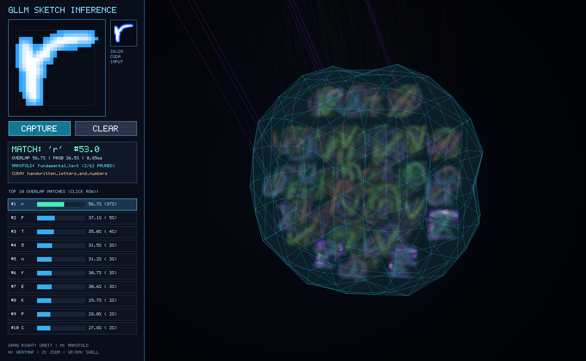
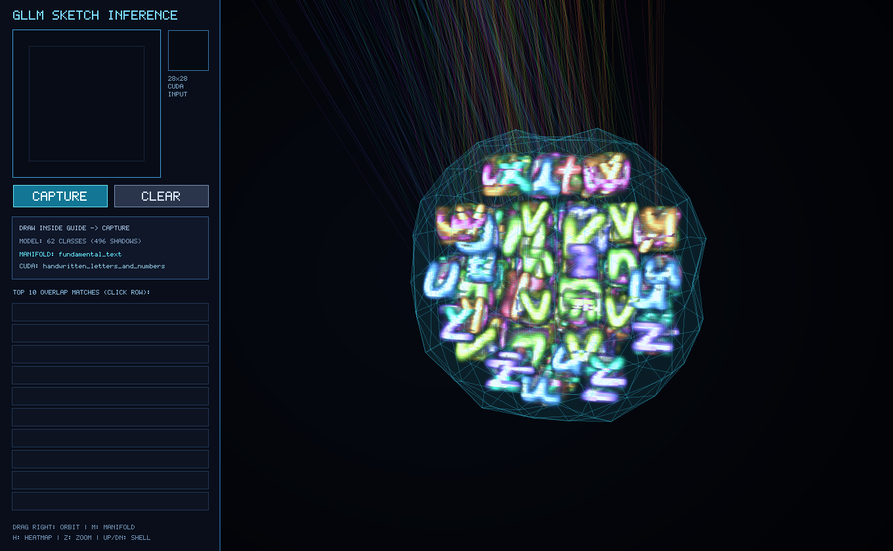

# Geometry-Based Large Language Model (GLLM)

> **Intelligence represented purely as geometry** — a zero-weight, zero-backpropagation CUDA Driver API + OpenGL 4.6 geometric intelligence engine designed to run at **~97,000 images/sec** with **sub-millisecond interactive inference** on consumer GPUs (no `nvcc` / CUDA Toolkit required).

<p align="center">
  
  
</p>
<p align="center">
  <em>Left: Live 2-stage CUDA sketch inference (<code>MATCH: 'r' #53.0</code>, <code>56.7%</code> overlap, <code>0.78 ms</code>) routed on GPU to Operational Manifold <code>fundamental_text</code> (<code>CUDA: handwritten_letters_and_numbers</code>).<br/>Right: Minimum-volume deformed-sphere Operational Manifold tightly encapsulating all 62 classes (496 non-overlapping sub-shadows, <code>0.216%</code> of the 1B sphere) bound to 62 outer-shell nodes.</em>
</p>

---

## Operational Manifolds (Cortical Specialization Inside the 1B Sphere)

Just as the human brain dedicates specialized anatomical regions to distinct modalities (vision, reading, motor control), GLLM organizes the **1-billion-point implicit 3D sphere lattice (`1241³`)** into standardized, isolated **Operational Manifolds**:

- **Minimum-Volume Spherical Packing (0 Overlap):** Every class belonging to a manifold packs radially outward from its manifold anchor in strict Euclidean-distance order (`pad_xy=1, pad_z=2`), minimizing enclosed 3D volume while guaranteeing **zero spatial overlap** between subspaces and between separate manifolds.
- **Tight Deformed-Sphere Envelope:** Around each tightly packed cluster, GLLM computes a **162-vertex geodesic deformed-sphere boundary** (a conformally fitted organic shell — it does not waste volume forcing a perfect sphere) that strictly encloses 100% of its subspaces with minimal skin margin.
- **CUDA-Resident Semantic Metadata Register (`GpuManifoldDesc`):** Each Operational Manifold is formally registered inside CUDA VRAM as a 128-byte aligned metadata struct containing its `manifold_id`, tight 3D bounds, volume fraction, `name`, and `semantic_label`. During inference, the CUDA PTX kernel **`route_operational_manifolds`** aggregates active sub-shadows per manifold directly on the GPU.
- **Standardized Domain Modularity:**
  - **Manifold `#0` (`fundamental_text` / CUDA label: `handwritten_letters_and_numbers`):** Encapsulates all `62` core alphanumeric classes (`0–9`, `A–Z`, `a–z` → `496` clustered sub-shadows) inside **`< 0.1%`** of the 1B-point sphere volume.
  - **Future Manifolds (`#1`, `#2`, …):** Train any new domain into its own isolated Operational Manifold inside the *same* `.gllm` universe sphere using `--manifold <name> --manifold-label <semantic_tag>` (e.g., `geometric_shapes`, `mammal_eyes`, `mammal_ears`, `mammal_mouth`) — automatically anchored outside existing manifold envelopes with zero interference.

---

## Core Architecture

GLLM maps patterns onto a **1-billion-point implicit 3D sphere lattice** (`1241³`, **0 bytes** for unallocated space) bound to a permanent **1.2M-point outer shell** (`R = 1.0`). Every Operational Manifold owns a non-overlapping deformed-sphere zone; every class inside it owns one unique outer-shell node and `K` non-overlapping `W×H×1` sub-shadows discovered via GPU Spherical K-Means. All five standalone GPU CLI tools share a single self-describing `.gllm` binary checkpoint (v2, backwards-compatible with v1):

| CLI Tool | Purpose |
|---|---|
| **`bin/gllm_train`** | Allocates tight minimum-volume **0-overlap** subspaces inside a named Operational Manifold (`--manifold`, `--manifold-label`), clusters multi-modal shape variants on GPU (`--clusters K`), and computes the deformed-sphere envelope. |
| **`bin/gllm_eval`** | Evaluates any unseen IDX or PGM/PPM folder dataset directly on GPU (`eval_score_shadows`), max-pooling across every class's `K` sub-shadows. |
| **`bin/gllm_bench`** | Reproducible end-to-end audit suite: verifies **0 spatial overlaps**, **100% deformed-sphere containment**, CUDA **`GpuManifoldDesc` register routing**, the full **68,405-image holdout**, and **Open-World OOD rejection**. |
| **`bin/gllm_inspect`** | Inspects, queries (`--label` / `--value`), or exports (`--json` / `--csv`) both the Operational Manifold registry and the serialized outer-shell ↔ 3D lattice lookup table. |
| **`bin/gllm_viz`** | Zero-copy CUDA–OpenGL 4.6 3D visualizer rendering translucent deformed-sphere Operational Manifolds (`M` to toggle) + **Interactive Sketch Inference Canvas** (`224×224` fixed `8:1` downsampling, 64-bit bitmask pruning, 9-shift `Symmetric Bernoulli × Soft-IoU`, GPU manifold routing, `< 28%` `UNKNOWN` gate). |

---

## Prerequisites

- **Linux with an NVIDIA GPU** and standard NVIDIA driver (`libcuda.so` — **no CUDA Toolkit / `nvcc` needed**; PTX kernels in `kernels/gllm_kernels.ptx` are JIT-compiled by the driver at runtime).
- `g++` (C++17), `SDL2`, `OpenGL 4.6`, `zlib`, `curl`.
- Optional for custom PNG/JPG/BMP conversion: `python3` + `pillow` (or `ffmpeg` / `ImageMagick`).

```bash
# Ubuntu / Debian
sudo apt install build-essential libsdl2-dev libgl-dev zlib1g-dev curl

# Arch / CachyOS
sudo pacman -S base-devel sdl2 mesa zlib curl

# Fedora
sudo dnf install gcc-c++ SDL2-devel mesa-libGL-devel zlib-devel curl
```

---

## Quick Start (Build → Train → Benchmark → Visualize)

You can use either `make` or `./scripts/*.sh` directly:

### 1. Build All 5 GPU CLIs
```bash
./scripts/build.sh
# or: make
```

### 2. Download & Train the 62-Class 1B-Sphere Model (`0–9`, `A–Z`, `a–z`)
Downloads MNIST (`60,000` digits) + EMNIST ByClass (`352,897` letters) and trains **496 non-overlapping sub-shadows** (`K=8` clusters/class → `62` unique outer-shell nodes) in `< 1 second` of GPU kernel time:
```bash
./scripts/train_digits_and_letters.sh
# or: make train
```

### 3. Run the Full Reproducible Benchmark (68,405 Unseen Images + OOD Audit)
```bash
./scripts/benchmark.sh
# or: make benchmark
```

### 4. Launch the Interactive 3D Sphere & Live Sketch Inference UI
```bash
./scripts/run_viz.sh --model models/sphere_1b.gllm
# or: make viz
```

---

## Verified Benchmark Results (`models/sphere_1b.gllm`, `K=8`, RTX A3000 Laptop GPU)

Zero neural weights, zero gradient steps, **0 spatial overlaps** across `496` subspaces (`62` unique outer-shell nodes):

### Full Unseen Holdout Evaluation (`68,405` images in `0.70 s` total GPU time)
| Unseen Holdout Dataset | Images | 10-Way Digits | Exact 62-Way Top-1 | Visually-Equiv (`case`, `0/O/o`, `1/I/l`) | 62-Way Top-3 | GPU Throughput |
|---|---:|---:|---:|---:|---:|---:|
| **MNIST Test Digits (`0–9`)** | `10,000` | **92.02%** | **83.48%** | **87.76%** | **94.91%** | `87,152 imgs/s` |
| **EMNIST ByClass Letters (`A–Z, a–z`)** | `58,405` | — | **58.99%** | **79.43%** | **87.55%** | `99,304 imgs/s` |
| **Combined All Unseen** | **`68,405`** | — | **62.57%** | **80.65%** | **88.63%** | **`~97k imgs/s`** |

### Live Interactive CUDA Matcher (`9-Shift Symmetric Bernoulli × Continuous Soft-IoU`, `< 28%` `UNKNOWN` Gate)
- **Latency:** `0.61–0.98 ms` per query across all `496` sub-shadows (`× 9` micro-shifts).
- **Valid Unseen Characters (`6,200` stratified):** **90.30%** 10-way digits, **78.60%** visually-equivalent letters (**87.3%** Top-3), **98.7%** accepted above threshold.
- **Open-World Rejection (`50` dots & short strokes):** **100%** of single click-dots (`max ~8.7%`) rejected as **`UNKNOWN`**, **88%** overall partial-stroke rejection.

---

## Train Your Own Custom Dataset

Nothing in GLLM is hardcoded to digits or letters. You can train **any image dataset** into a fresh `.gllm` sphere or append new classes incrementally into an existing checkpoint:

### Option A: Zero-Dependency 30-Second Shape Demo
```bash
./scripts/train_custom.sh --model models/demo_shapes.gllm --demo --clusters 4
./scripts/run_viz.sh --model models/demo_shapes.gllm
# or: make demo
```

### Option B: Custom PNG / JPG / BMP / PGM Class Folders
Organize images as `<dataset>/<class_name>/*.*` and run:
```bash
# Bright strokes on dark background (MNIST/EMNIST style):
./scripts/train_custom.sh --model models/my_model.gllm --input my_dataset --center --clusters 8

# Dark drawings/scans on white paper (auto-inverts background):
./scripts/train_custom.sh --model models/my_model.gllm --input my_dataset --auto-invert --center --clusters 8
```
> **Continual Learning:** Point `--model` at an existing checkpoint (e.g. `models/sphere_1b.gllm`) to append new classes into fresh, guaranteed non-overlapping 3D spaces without touching prior classes.
>
> **Arbitrary Resolutions:** Use `--size 32` or `--size 64` for non-`28×28` grids (`gllm_train`, `gllm_eval`, `gllm_inspect`, and 3D `gllm_viz` support arbitrary `W×H`; `28×28` enables the live interactive sketch matcher).

### Option C: Any Custom IDX `.gz` Dataset (Fashion-MNIST, KMNIST, EMNIST, etc.)
```bash
./bin/gllm_train \
  --model models/fashion.gllm \
  --idx-images path/to/train-images-idx3-ubyte.gz \
  --idx-labels path/to/train-labels-idx1-ubyte.gz \
  --clusters 8 \
  --label-names T-shirt,Trouser,Pullover,Dress,Coat,Sandal,Shirt,Sneaker,Bag,AnkleBoot
```

Key `gllm_train` flags:
- `--manifold <name>` — Operational Manifold name (default `fundamental_text`; each distinct name gets its own isolated non-overlapping 3D zone).
- `--manifold-label <tag>` — Formal CUDA semantic metadata label stored in `GpuManifoldDesc` VRAM registers (default `handwritten_letters_and_numbers`).
- `--clusters <K>` — GPU Spherical K-Means sub-shadows per class (default `1`; e.g., `8` isolates structural variants).
- `--cluster-iters <I>` — Spherical K-Means iterations (default `10`).
- `--min-raw-label <N> --max-raw-label <M>` — Filter raw IDX label range.
- `--label-offset <O>` — Subtract offset before indexing `--label-names`.
- `--transpose` — Transpose row/column layout (required for EMNIST).
- `--grid <G>` — Implicit sphere lattice grid dimension (default `1241` → ~1.0B sphere points).

---

## Inspect & Evaluate Checkpoints

```bash
# Inspect serialized outer-shell <-> 3D lattice lookup table
./bin/gllm_inspect --model models/sphere_1b.gllm
./bin/gllm_inspect --model models/sphere_1b.gllm --label r
./bin/gllm_inspect --model models/sphere_1b.gllm --json > lookup_table.json

# Evaluate any unseen test dataset on GPU (IDX or folder of PGM/PPM)
./bin/gllm_eval \
  --model models/sphere_1b.gllm \
  --idx-images data/mnist/t10k-images-idx3-ubyte.gz \
  --idx-labels data/mnist/t10k-labels-idx1-ubyte.gz
```

---

## Interactive Visualizer Controls (`gllm_viz`)

- **Left Sketch Canvas (`224×224`, fixed 8:1 raw-proportion scale):** `Left-drag` draw inside the subtle `22×22` scale guide • `[CAPTURE]` or `Enter` run 2-stage CUDA match • `[CLEAR]` / `Right-click` / `C` clear • Click any **Top-10 row** to spotlight all `K` sub-shadows of that class in 3D.
- **Right 3D Sphere Viewport:** `Left-drag` / `Scroll` orbit & zoom • `M` toggle Operational Manifold deformed-sphere shell • `Z` toggle core close-up vs. full 1B sphere • `Left / Right / Space` cycle class focus • `H` thermal density heatmap • `L` toggle `K`-to-1 binding rays • `Up / Down` ghost-reveal unassigned 1.2M outer-shell points • `R` reset view • `Q / Esc` quit.

---

## Repository Layout

```text
Makefile                              # Convenient build / train / benchmark / demo / viz targets
include/
  cuda_driver_min.hpp                 # Minimal CUDA Driver API bindings (libcuda.so, no nvcc)
  gllm_model.hpp                      # .gllm format, 0-overlap 3D allocator, IDX & folder loaders
  hud_canvas.hpp                      # 224x224 raw-proportion sketch canvas & HUD renderer
kernels/
  gllm_kernels.ptx                    # JIT-compiled CUDA PTX kernels (shell, train, eval, emit, match)
  gllm_kernels.cu                     # Readable CUDA C++ reference mirror
src/
  gllm_train.cpp                      # GPU shadow trainer + Spherical K-Means clustering
  gllm_eval.cpp                       # GPU batch holdout evaluator
  gllm_bench.cpp                      # Full holdout + live Soft-IoU matcher + OOD + overlap auditor
  gllm_inspect.cpp                    # .gllm outer-point lookup table inspector & exporter
  gllm_viz.cpp                        # Interactive 3D CUDA-OpenGL visualizer + live sketch inference
scripts/
  build.sh                            # Compiles all 5 CLIs into bin/
  download_mnist.sh                   # Idempotent MNIST downloader
  download_emnist_byclass.sh          # Idempotent EMNIST ByClass downloader
  train_digits_and_letters.sh         # One-command 62-class (0-9, A-Z, a-z) 1B-sphere trainer
  benchmark.sh                        # One-command 68,405-image holdout + OOD benchmark suite
  prepare_custom_dataset.py           # Converts custom PNG/JPG/BMP folders (or demo) to PGM
  train_custom.sh                     # One-command custom dataset converter + GPU trainer
  run_viz.sh                          # NVIDIA PRIME offload launcher for gllm_viz
```
