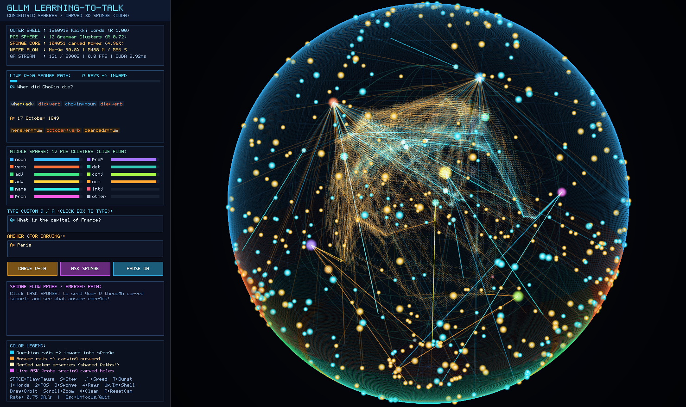
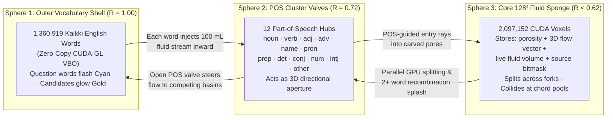

# Geometry-Based Large Language Model (GLLM) — Concentric Fluid Sponge Architecture

> **Intelligence modeled directly on nature: water droplets carving, merging, splitting, and recombining inside a porous 3D sponge.**  
> A **zero-weight, zero-backpropagation** CUDA Driver API (`libcuda.so`, no `nvcc`) + OpenGL 4.6 geometric language engine built on **three concentric spheres**: a **1.36M-word outer English vocabulary shell (`R = 1.00`)**, a **12-cluster Part-of-Speech valve sphere (`R = 0.72`)**, and a **`128³` (2,097,152-voxel) carvable 3D fluid sponge (`R < 0.62`)**.

<p align="center">
   #1 Paris (16.5 mL)" width="49%" />
  
</p>
<p align="center">
  <em><strong>Left (Live Q&A Fluid Splitting &amp; Recombination):</strong> Asking <code>"What is the capital of France?"</code> (a phrasing not literally present in SQuAD v1.1) injects independent fluid streams from <code>capital</code> and <code>France</code> into the <code>128³</code> CUDA sponge. Fluid physically splits across <strong>6,225 forks</strong> and <strong>6,337 active voxels</strong> (electric cyan = 1-word fluid weight) and collides across <strong>769 multi-word recombination voxels</strong> (blazing magenta–gold core). Every competing answer fills its live fluid meter until <strong><code>#1 Paris</code> (<code>16.5 mL</code>, <code>2/2 drops + POS valve</code>)</strong> emerges as the highest-fluid winner.<br/>
  <strong>Right (Real-Time Sponge Carving Stream):</strong> Streaming <code>89,003</code> English Q&amp;A pairs through the <code>1,360,919</code>-word outer dictionary sphere and 12 POS clusters—boring cyan inward and amber outward water channels that naturally merge into shared trunks (<code>90.8%</code> merge rate) and split back out to answer words.</em>
</p>

---

## The Nature & Fluid Philosophy: Why a Porous 3D Sponge?

Traditional language models compress all language knowledge into billions of opaque floating-point matrix weights tuned by backpropagation. GLLM takes a completely different first-principles view inspired directly by **how fluids behave in nature**:

1. **Think of Water Flowing Down a Tree Branch:**
   - When rain falls onto a branching tree, a single drop of water doesn't have to stay a single rigid marble. As it meets forks and ridges, **one droplet splits into 2, 3, or 10 smaller streams** depending purely on the physical geometry it encounters.
   - Downstream, **separate droplets from different branches meet and merge back together** into thicker shared trunks—and then split again further down the branch.
2. **A Carvable Porous Sponge (Zero Hardcoded Grammar Rules):**
   - Between the outer vocabulary and the core sits a **3D porous sponge** (`128³ = 2,097,152` CUDA voxels) that begins completely solid (high resistance, zero hardcoded syntax connections).
   - As real English Question–Answer pairs stream through the geometry, rays pierce from the outer words through their Part-of-Speech clusters and **spear tunnels directly through the sponge**.
   - Just like water eroding riverbeds or lightning following ionized air, new rays bend smoothly toward **already-carved nearby pores**. Repeated patterns erode wider, lower-resistance main arteries, while specific facts carve fine capillaries out to their exact answer words.
3. **Answering a Question = Parallel Fluid Splitting & Constructive Splash:**
   - When you ask a question like **`"What is the capital of France?"`**:
     - Every content word (`capital`, `France`) releases its own **fluid stream (`100 mL`)** into the sponge—each tagged with a unique hardware bitmask (`source_bit`).
     - In parallel across all **2.1 million voxels** on the GPU (`step_fluid_split_recombine`), each active voxel **splits its fluid proportionally across all open carved neighbor tunnels** based on local porosity and directional flow alignment.
     - Single-word branches carry only partial, diluted fluid (`Europe` gets a drop from `France`; `Melbourne` and `Beijing` get a drop from `capital`).
     - Only where split streams from **multiple question words physically collide inside the sponge** (`capital` ∩ `France` at their 3D chord-midpoint pool) do the waves **recombine into a high-pressure magenta–gold splash**—guided out through the open **POS valve** (`NAME/NOUN` for `"What is ...?"` vs. `NUM/DATE` for `"When ...?"`).
   - **Every possible candidate answer** is initialized and tracked visibly as a fluid basin both on the 3D outer sphere and in the live HUD fluid meters. At the end of the wave, **the answer holding the highest accumulated fluid volume (`mL`) wins.**

---

## Concentric 3-Sphere Architecture



### How Each Sphere Works
1. **Outer Vocabulary Sphere (`R = 1.00`):** Holds all **`1,360,919` unique English words** extracted from [Kaikki English Wiktionary](https://kaikki.org/dictionary/rawdata.html) (every entry mapped to its Parts of Speech with **0 missing POS**), placed deterministically on the unit sphere in double precision inside a zero-copy CUDA–OpenGL VBO (`init_word_outer_shell`).
2. **Middle POS Cluster Sphere (`R = 0.72`):** 12 evenly spaced grammatical cluster hubs (`noun`, `verb`, `adj`, `adv`, `name`, `pron`, `prep`, `det`, `conj`, `num`, `intj`, `other`). Every outer word links inward to its POS cluster—and during inference, the question's opening (`What / Who / Where` vs. `When / How many`) opens the matching **POS valve** so fluid flows toward the right kind of answer (a place/name vs. a date/number).
3. **Core `128³` Carvable Fluid Sponge (`R < 0.62`):**
   - **During Carving (`carve_sponge_voxels`):** GPU atomic operations (`atom.global.add.f32`) erode 3D porosity, directional flow vectors `(fx, fy, fz)`, and Q/A polarity directly in VRAM.
   - **During Question Probing (`inject_fluid_drops` + `step_fluid_split_recombine`):** Double-buffered parallel CUDA fluid simulation splits mass across 6-neighbor carved pores, atomically OR-ing source bitmasks (`atom.global.or.b32`) so `popc(fmask) >= 2` immediately detects and highlights **multi-word collision hotspots** in real time.
   - **Zero-Copy Voxel Weight Visualization (`emit_sponge_voxels`):** Every active fluid voxel is emitted straight into an OpenGL VBO with brightness and sprite size proportional to **the exact fluid weight carried by that voxel**—electric cyan for 1-word split streams, blazing magenta–gold for 2+ word recombined collisions!

---

## Verified Live Fluid-Wave Result (Unseen Question Phrasing)

Evaluated directly in `bin/gllm_talk_viz` on an **NVIDIA RTX A3000 Laptop GPU** after indexing all **`89,003` SQuAD v1.1 Q&A pairs** (`63,384` unique answer basins) and **`1,360,919` Kaikki English words**—with **zero hardcoded answers and zero neural weights**:

- **Query:** `"What is the capital of France?"` *(exact phrasing does not appear in SQuAD v1.1; the dataset only contains indirect references such as "What capital of France was lost to the Nazi Germans?" → "Paris")*
- **Live `128³` CUDA Voxel Telemetry (Step 54 / 72, `9.0 ms` CUDA frame):**
  - **Active Fluid Voxels:** `6,337`
  - **Splitting Forks (`degree >= 2`):** `6,225`
  - **Multi-Word Collision Voxels (`popc(fmask) >= 2`):** `769`
  - **Peak Single-Voxel Fluid Weight:** `6.32`
- **Competing Candidate Answer Fluid Meters:**

| Rank | Competing Candidate Answer | Accumulated Fluid | Drop Recombination & Valve | Status |
|---:|---|---:|---|---|
| **#1** | **`Paris`** | **`16.5 mL`** | **`2/2 drops + POS valve (NAME/NOUN)`** | **Highest-Fluid Winner** |
| #2 | `Brazzaville` | `14.5 mL` | `2/2 drops + POS valve` | Runner-up (Free France WWII capital) |
| #3 | `6` | `4.2 mL` | `2/2 drops` | Damped by `NAME/NOUN` POS valve |
| #4 | `Melbourne` | `4.4 mL` | `1/2 drops + POS valve` | Single-word (`capital`) split stream |
| #5 | `one` | `4.1 mL` | `2/2 drops` | Damped by POS valve |
| #6 | `1790` | `3.2 mL` | `2/2 drops` | Damped by POS valve |

---

## Quick Start: Run the Real-Time CUDA Fluid Sponge

### Prerequisites
- Linux + NVIDIA GPU + standard NVIDIA driver (`libcuda.so` — **no `nvcc` / CUDA Toolkit required**)
- `g++` (C++17), `SDL2`, `OpenGL 4.6`, `zlib`, `python3`, `curl`

```bash
# Arch / CachyOS
sudo pacman -S base-devel sdl2 mesa zlib curl python

# Ubuntu / Debian
sudo apt install build-essential libsdl2-dev libgl-dev zlib1g-dev curl python3
```

### 1. Prepare Datasets (Kaikki English Wiktionary + SQuAD v1.1)
If you haven't already downloaded the raw datasets onto your local data drive (`GLLM_DATA`), download and index them into the compact binary lexicon (`19.3 MB`) and clean Q&A stream (`6.5 MB`):

```bash
python3 scripts/prepare_talk_data.py \
  --kaikki /run/media/liveuser/GLLM_DATA/gllm_datasets/extracted/kaikki_english/kaikki.org-dictionary-English.jsonl \
  --squad-train /run/media/liveuser/GLLM_DATA/gllm_datasets/raw/squad-train-v1.1.json \
  --squad-dev /run/media/liveuser/GLLM_DATA/gllm_datasets/raw/squad-dev-v1.1.json \
  --out-dir /run/media/liveuser/GLLM_DATA/gllm_datasets/extracted/talk_index
```

### 2. Build & Launch Live in 3D
```bash
./scripts/build.sh
./scripts/run_talk_viz.sh --ask "What is the capital of France?"
# or: make talk-viz
```

### Interactive Controls (`gllm_talk_viz`)
- **Type & Ask Live:** Click the **`Q:`** box, type any English question, and press **`Enter`** (or click **`[ASK (FLUID)]`**) to launch a real-time CUDA fluid splitting wave and watch every competing candidate fill its fluid meter.
- **Carve Custom Knowledge Live:** Click **`Q:`** and **`A:`**, type a new question & answer, and click **`[CARVE Q->A]`** to watch your own droplets bore new tunnels through the sponge.
- **Replay / Stream Controls:** **`[REPLAY FLUID WAVE]`** replay the voxel wave in slow motion • **`[INDEX ALL 89K]`** load all 89,003 SQuAD Q&As • **`Space`** play/pause real-time Q&A carving stream • **`T`** burst carving (20 Q&As/frame) • **`S`** single-step • **`+`/`-`** speed • **`X`** clear sponge.
- **3D Viewport:** `Left-drag` / `Scroll` orbit & zoom • **`1`** Outer Word Sphere • **`2`** Middle POS Sphere • **`3`** `128³` Fluid Sponge • **`4`** Splitting/Carving Rays • **`Up`/`Down`** outer shell transparency • **`A`** auto-rotate • **`R`** reset camera • **`Q`/`Esc`** quit.

---

## Visual Geometry Foundation (Previous Milestones Preserved)

The concentric fluid sponge builds directly on GLLM's earlier zero-weight visual geometry engine (all 8 visual CLIs remain built and runnable via `./scripts/build.sh`):

- **Unified 1-Billion-Point Sphere (`1241³`)** with nested 3D bounding-box manifolds (`handwritten → numbers / letters` and 4-level true-RGB `animals → cats / dogs → face → 6 facial features`), `0` spatial overlaps, `2,048 / 2,048` corners enclosed, and dynamic per-manifold CUDA inference dispatch ([include/inference_dispatcher.hpp](include/inference_dispatcher.hpp)).
- **68,405-Image Unseen Holdout:** `92.02%` 10-way MNIST digits, `80.65%` visually-equivalent 62-way Top-1 (`88.63%` Top-3) at `~120k imgs/s`, and `100%` OOD rejection (`./scripts/benchmark.sh`).

---

## Repository Layout

```text
Makefile                              # Build / talk-viz / train / benchmark / viz targets
include/
  cuda_driver_min.hpp                 # Minimal CUDA Driver API bindings (libcuda.so, no nvcc)
  talk_hud.hpp                        # Left sidebar HUD: live voxel telemetry, Q/A typing & Top-8 fluid meters
  gllm_model.hpp                      # .gllm v5 schema, 3D-box hierarchical manifolds & RGB storage
  gaussian_pyramid.hpp                # Burt-Adelson multi-scale Gaussian Pyramid
  hud_canvas.hpp                      # 5x7 bitmap font & 224x224 visual sketch canvas
  inference_dispatcher.hpp            # Per-root-manifold CUDA inference dispatcher
kernels/
  gllm_talk_kernels.ptx               # JIT-compiled CUDA PTX: 1.36M outer shell, sponge carving, 128^3 fluid splitting & recombination
  gllm_talk_kernels.cu                # Readable CUDA C++ reference mirror for fluid sponge kernels
  gllm_kernels.ptx                    # JIT-compiled CUDA PTX for visual shadow training, matching & routing
  gllm_kernels.cu                     # Readable CUDA C++ reference mirror for visual kernels
src/
  gllm_talk_viz.cpp                   # Real-time CUDA-OpenGL 4.6 Concentric Fluid Sponge visualizer
  gllm_train.cpp                      # GPU shadow trainer + Spherical K-Means
  gllm_pyramid.cpp                    # RGB Burt-Adelson Gaussian Pyramid lattice mapper
  gllm_hierarchy.cpp                  # 4-level RGB animals hierarchy builder
  gllm_merge.cpp                      # Unified 1B universe sphere merger
  gllm_eval.cpp                       # Batch GPU evaluator
  gllm_bench.cpp                      # Full holdout, containment & OOD auditor
  gllm_inspect.cpp                    # Checkpoint hierarchy & lookup inspector
  gllm_viz.cpp                        # Interactive 3D visual sphere + sketch capture UI
scripts/
  prepare_talk_data.py                # Builds fast binary Kaikki 1.36M lexicon + 89k SQuAD Q&A stream
  run_talk_viz.sh                     # NVIDIA PRIME offload launcher for gllm_talk_viz
  build.sh                            # Compiles all 9 standalone C++17 / CUDA CLIs into bin/
  train_digits_and_letters.sh         # Hierarchical handwritten trainer
  benchmark.sh                        # Reproducible 68,405-image holdout benchmark
  run_viz.sh                          # Launcher for visual gllm_viz
docs/images/
  gllm_fluid_sponge_qa.png            # Live parallel CUDA voxel fluid splitting -> #1 Paris (16.5 mL)
  gllm_sponge_carving.png             # Real-time Q&A water-artery carving through the 128^3 sponge
```
